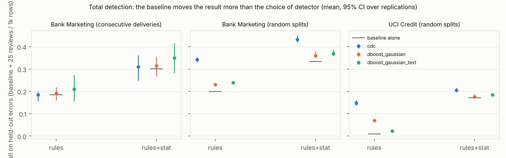

# Comprehensive feasibility pilot: dataset readiness, detector comparison and selection reliability

Date: 2026-10-20 · branch `claude/exciting-ritchie-w1e31t` · MSc AI thesis (Avanade, Rabobank-related context;
**public data only**). Status: **feasibility pilot, all results provisional**. The confirmatory study has not
been run; the split-seed-1 test partition was never read.

Labels used throughout: **[measured]** computed in this repository (commands in §12); **[lit]** taken from a
primary source; **[assumption]** a design choice or interpretation; **[open]** not answered.

---

## 0. Summary

- **Datasets [measured].** Seven registered datasets download and verify (SHA-256 + shape) in a fresh
  container. Give Me Some Credit is integrated but **blocked**: the Kaggle API returns 403 until the competition
  rules are accepted for the account. TableEG Credit is a derivative of GMSC via CleanML, with HoloClean
  repairs as its "clean" version, so it is not ground truth. BAF downloads but stays out of the pilot because of
  its licence. Details: `docs/dataset_overview.md`.
- **Detectors [measured].** CDC and dBoost (clean-room re-implementation; 100 % cell agreement with the GPL
  original) are the primary label-free, scored cell-level detectors. The dBoost score is its own Gaussian test
  statistic (D-27). LUCARIO-core, SD, IQR, the dBoost histogram model and Isolation Forest are qualified as
  secondary detectors. ZeroED is blocked. Raha is a separate few-label track.
- **Pilot [measured].** 14 replications on three financial units:
  - UCI Credit, 5 random splits;
  - Bank Marketing, 5 random splits;
  - Bank Marketing, 4 consecutive delivery sets.

  That is 4,946 injected scenarios. 150 delivery-set scenarios could not be injected (structurally
  ineligible); none failed in the random splits.
- **Main question.** For *total* detection, the baseline matters more than the choice of detector in every unit
  at k ≤ 25 reviews per 1,000 rows. Adding statistical controls raises recall on held-out errors by 0.11–0.16;
  switching detector changes it by 0.03–0.07. For the *increment* of a detector the picture is mixed:
  - On Credit the baseline moves the increment more than the detector does.
  - On Bank Marketing the detector choice matters more: CDC adds 0.10 at k = 25 over the strong baseline, dBoost 0.03.
  - Over the strong baseline the increments are small: 0.005–0.10 at k = 25. Only CDC on Bank Marketing (random
    splits) clears the pre-set 0.05 relevance threshold.
- **Selection reliability (secondary, but the most interesting finding) [measured].**
  - The detector that is best on the selection catalog is often *not* best on held-out error cases. Credit with
    the strong baseline: dBoost text mode wins on the catalog (0.058 vs 0.016), CDC wins on held-out cases (0.035
    vs 0.013). Regret is 0.02–0.06 at k = 25.
  - Injection strategy A vs B almost never changes the choice (83–97 % identical, regret difference ≈ 0).
  - On real non-financial benchmark errors (Flights, Beers), a selection made on synthetic errors also picks the
    wrong transductive detector.
- **Operational demo [measured].** `dqf scan` analyses a new batch without injection. It reports findings with
  record ID, column, value, source, score and explanation, and gives ADOPT, DO_NOT_ADOPT or
  INSUFFICIENT_EVIDENCE. All three outcomes occur on real batches; the shift guard blocks ADOPT on a new
  macro-economic regime.
- **Go / no-go: conditional GO** (§9).
  - Two usable detectors on three units, and a measurable difference between them whose sign depends on the unit.
  - A confirmatory study needs more *independent* sources or deliveries rather than more seeds. At δ = 0.02 that
    is ~20–50 delivery sets. The research question should move to *selection reliability under error-population
    shift, conditional on baseline strength*.

---

## 1. Scope, priorities and what changed during the pilot

The brief was extended mid-pilot with priorities that override the original plan:

1. **Primary analysis** = financial tables only and label-free, cell-level detectors that publish a score: CDC and
   dBoost (Gaussian model, scored by its own test statistic, D-27). Raha, ZeroED, Isolation Forest and BAF are
   not in the primary analysis. LUCARIO-core, the dBoost histogram model, SD and IQR (all binary) are secondary.
2. **Main question**: how much does a detector add over *each* baseline, and is the difference between baselines
   larger than the difference between detectors? Strategy A vs B is secondary.
3. More in-domain data: Give Me Some Credit (Kaggle) and Bank Marketing cut into consecutive deliveries;
   provenance of TableEG Credit.
4. External benchmarks are qualified and reported only, never used for main conclusions.
5. The operational demo with ADOPT / DO_NOT_ADOPT / INSUFFICIENT_EVIDENCE is kept.
6. The report ends with a go / no-go.

A first full run with binary dBoost was stopped when the priorities changed. Its five finished replications are
superseded by a complete rerun with identical scenarios and the scored dBoost, and are not used.

## 2. Artefacts delivered

| Component | Where | Status |
|---|---|---|
| Reproducible acquisition, status command, local manifest | `scripts/download_datasets.py`, `scripts/dataset_status.py` / `dqf datasets status`, `data/local_manifest.json` (git-ignored) | 7 VERIFIED in a fresh container; GMSC BLOCKED |
| Dataset overview | `docs/dataset_overview.md` | done |
| Detector research and compatibility | `docs/detector_comparison.md`, `docs/sources/detector_benchmark_research_notes.md`, `results/qualification/pilot_detector_qualification.json` | done |
| New detectors | `detectors/dboost.py` (clean-room + original via child process), `detectors/univariate.py` (LUCARIO-core, SD, IQR), `detectors/registry.py` | tested |
| Injection strategies, held-out family | `pilot/scenarios.py`, `config/pilot/*.yaml`, `docs/injection_strategies.md` | tested |
| Pilot runner and analysis | `pilot/{splits,metrics,runner,analysis,primary}.py`; `scripts/run_pilot.py`, `analyse_pilot.py`, `primary_analysis.py`, `render_pilot_tables.py` | run |
| Independent validation | `scripts/independent_validation.py`, `docs/independent_validation.md` | run |
| Operational scan | `service/scan.py`, `dqf scan`, `dqf feedback`, `config/scans/`, `reports/scans/`, `docs/operational_demo.md` | run |
| Research directions | `docs/post_pilot_research_directions.md` | done |

## 3. Qualification

### 3.1 Datasets [measured]

The six public datasets and BAF are VERIFIED (hashes, read-only, shapes). GMSC is BLOCKED: the API lists
`cs-training.csv` (7,564,965 bytes), but the download returns HTTP 403 until the competition rules are accepted
on kaggle.com. Copies of GMSC in CleanML and TableEG are *not* used as a substitute. TableEG Credit:

- `dirty.csv` equals CleanML's raw Credit file cell for cell [measured];
- CleanML names Kaggle GiveMeSomeCredit as its source [lit];
- the schema, row count and missing-value shares match GMSC — PROBABLE, because no byte comparison with the
  Kaggle original was possible;
- `clean.csv` is HoloClean output [measured].

So TableEG Credit has imputed, not verified, ground truth (`docs/sources/tableeg_gmsc_provenance.md`).

### 3.2 Detectors [measured unless marked]

| Detector | Verdict | Fit / score (pilot seed 11, Credit) | Flags on untouched data (cells per 1k rows) | Notes |
|---|---|---|---|---|
| CDC (`cdc_hgb`) | CONDITIONAL | 40 s / 2.2 s per 6k rows | 33 (Credit), 35 (Bank) | rare labels under Mondrian calibration (`method_compatibility.md`) |
| dBoost Gaussian, typed | PASS | 0.1 s / 0.1 s | 729 / 259 | bit / mod / date expansions of integers drive the alerts |
| dBoost Gaussian, text mode (as Raha/REIN call it) | PASS | 0.7 s / 1 s | 132 / 212 | length and signature features |
| dBoost histogram | PASS | 5 s / 4 s | 4,618 / 2,586 | flags whole minority classes |
| LUCARIO-core (partial, batch) | PASS (provisional) | – / 0.4 s | 114 / 136 | numeric rule switches itself off on skewed amounts |
| SD / IQR (batch) | PASS | – / 0.1 s | 231 / 1,063 (Credit) | numeric columns only |
| Isolation Forest (row) | PASS | 1 s / 0.1 s | 10 rows | record track only |
| dBoost original (GPL, child process) | fidelity reference | 60–80 s per 3k rows | – | **100 % cell agreement** with the re-implementation on Credit (3 models) and on Bank's 15 non-float columns; the original **crashes** (`math domain error`) on Bank's float columns |
| ZeroED | BLOCKED | – | – | no licence, missing module, needs an LLM [lit] |
| Raha | separate track | – | – | needs 20 labelled tuples [lit]; earlier result on Flights F1 0.77 |

Peak Python heap per detector ≤ 130 MB [measured; tracemalloc]. The pilot process peaks at ~5 GB for Bank
because of the stacked dbt batch: four parallel replications exceeded the container's memory limit (§10).

### 3.3 Injection [measured]

Only cells that actually changed count as injected errors. In all random-split replications realised = intended.
The error model follows Jung et al. as summarised by its authors (type / mechanism / rate,
`docs/injection_strategies.md`). Strategies A and B have identical case × rate × count structure (tested).

## 4. Pilot design (fixed before results; decision log D-17 … D-28)

- **Partitions.**
  - The split-seed-1 test partition (20 % of rows) is reserved for the confirmatory study and never read.
  - The remaining design pool is re-split per *pilot seed* into reference 50 % (fits statistical controls and
    detectors), selection 25 % and test 25 %. The split is group-aware: exact duplicates stay together.
  - Bank Marketing is also cut into four **consecutive delivery sets**: history, then the next delivery, then a
    later delivery (`config/pilot/pilot_uci_bank_marketing.yaml`; sets 3 and 4 share periods 11–15).
- **Units of analysis**: UCI Credit (5 random splits), Bank Marketing (5 random splits), Bank Marketing
  deliveries (4 sets). GMSC is blocked.
- **Scenarios per replication.** Primary error cases (Credit 14, Bank 11) × rates 1 % and 2 % × 3 scenarios,
  for each of two strategies on the selection partition:
  - strategy A: ECAR;
  - strategy B: rotation over ECAR, soft EAR/ENAR, tab_err windows and a realistic batch block.

  The same is repeated on the test partition with new seeds. On top of that come a **held-out family** of 10
  error cases and mechanism settings that neither strategy uses, and the sanity cases. Credit: 402 scenarios per
  replication; Bank: 328.
- **Baselines.** *rules* = the documented deterministic dbt rules. *rules+stat* = the same rules plus statistical
  controls fitted on the reference partition (envelopes, ratio and month-over-month checks, rare categories,
  macro lookup). Neither baseline was changed after injection results were seen.
- **Budgets.** k = 10, 25, 50 extra review cells per 1,000 rows, on top of the baseline's own alerts.
- **Metrics.** Ground truth = cells whose value actually changed.
  - Primary: ranked incremental recall dR@k = the share of injected cells among the k highest-scored cells the
    baseline did not alert.
  - Secondary: flag recall and precision (a lower bound); flag-based dR@k for binary methods (expected yield when
    their extra flags are reviewed in random order); extra alerts on untouched cells per 1,000 rows (burden);
    target-column AUC; overlap; runtime.
  - Error cases are weighted equally. Injection seeds within a replication are averaged before any interval is
    computed. Intervals are percentile bootstraps over replications (5 or 4, so coarse).
- **Selection and decision.**
  - On the selection scenarios the candidate with the highest utility is chosen.
  - ADOPT if the lower 95 % cluster-bootstrap bound over error cases is ≥ 0.05; DO_NOT_ADOPT if the upper bound
    is < 0.05; otherwise INSUFFICIENT_EVIDENCE.
  - Regret on a test set = best utility minus the utility of the selected candidate.

## 5. Primary results [measured]

### 5.1 What the existing controls catch (recall of injected errors; selection scenarios, ECAR)

| Unit | Family | rules | rules+stat |
|---|---|---|---|
| Credit | keying (LIMIT_BAL digit transposition) | **0.53** | 0.63 |
| Credit | scale (×10, ÷1000 on bills/payments) | 0.00 | 0.26 (BILL_AMT1 ×10: 0.63; PAY_AMT1 ×10: 0.11; ÷1000: 0.05) |
| Credit | valid-but-wrong category | 0.00 | 0.08 (PAY_0 code remap 0.31; frequency-weighted swaps ≈ 0) |
| Credit | plausible substitution / period shift / rounding | 0.00 | 0.09 / 0.004 / 0.003 |
| Bank (random) | scale (duration in minutes; euribor as fraction) | 0.00 | 0.82 (0.63; 1.00) |
| Bank (random) | month shift / month swap | 0.00 | **1.00** (macro-indicator lookup) |
| Bank (random) | other valid-category swaps, substitutions, keying | 0.00 | ≤ 0.002 |
| all | sanity (missing, invalid code, negative payment) | 1.00 | 1.00 |

Held-out family with rules+stat: LIMIT_BAL ×10 0.54, BILL_AMT3 ×10 0.54, AGE transposition 0.38, Bank age in
months 1.00, `cons.conf.idx` substitution 1.00. Swaps (PAY_3, marital, loan, contact), weekday shift, period
shift and rounding: ≤ 0.13.

### 5.2 Increment of each detector over each baseline (held-out error cases; mean [95 % CI over replications])

| Unit | k | baseline | recall of baseline | CDC | dBoost Gaussian | dBoost Gaussian (text) |
|---|---|---|---|---|---|---|
| Credit (5 splits) | 10 | rules | 0.009 | 0.012 [0.003, 0.020] | 0.025 [0.024, 0.026] | 0.013 [0.012, 0.014] |
| | 10 | rules+stat | 0.171 | 0.002 [0.001, 0.003] | 0.001 [0.000, 0.001] | 0.013 [0.012, 0.014] |
| | 25 | rules | 0.009 | **0.139 [0.127, 0.153]** | 0.061 [0.056, 0.068] | 0.014 [0.013, 0.015] |
| | 25 | rules+stat | 0.171 | 0.035 [0.029, 0.043] | 0.005 [0.001, 0.013] | 0.013 [0.013, 0.015] |
| | 50 | rules | 0.009 | 0.207 [0.203, 0.212] | 0.109 [0.105, 0.116] | 0.017 [0.015, 0.020] |
| | 50 | rules+stat | 0.171 | 0.072 [0.067, 0.077] | 0.020 [0.014, 0.026] | 0.016 [0.014, 0.018] |
| Bank, random (5 splits) | 10 | rules | 0.200 | 0.082 [0.074, 0.090] | 0.013 [0.012, 0.014] | 0.020 [0.019, 0.021] |
| | 10 | rules+stat | 0.333 | 0.075 [0.069, 0.083] | 0.000 | 0.017 [0.016, 0.018] |
| | 25 | rules | 0.200 | **0.143 [0.131, 0.152]** | 0.031 [0.027, 0.035] | 0.039 [0.038, 0.041] |
| | 25 | rules+stat | 0.333 | **0.099 [0.094, 0.102]** | 0.027 [0.024, 0.029] | 0.035 [0.034, 0.037] |
| | 50 | rules | 0.200 | 0.232 [0.229, 0.235] | 0.044 [0.044, 0.045] | 0.108 [0.104, 0.111] |
| | 50 | rules+stat | 0.333 | 0.122 [0.117, 0.129] | 0.031 [0.031, 0.032] | 0.096 [0.092, 0.098] |
| Bank, deliveries (4 sets) | 10 | rules | 0.184 | 0.000 | 0.007 [0.000, 0.020] | 0.015 [0.000, 0.045] |
| | 10 | rules+stat | 0.302 | 0.008 [0.001, 0.018] | 0.004 [0.000, 0.013] | 0.030 [0.005, 0.054] |
| | 25 | rules | 0.184 | 0.000 | 0.007 [0.000, 0.020] | 0.025 [0.000, 0.075] |
| | 25 | rules+stat | 0.302 | 0.009 [0.002, 0.019] | 0.012 [0.000, 0.037] | **0.047 [0.016, 0.068]** |
| | 50 | rules | 0.184 | 0.000 | 0.007 [0.000, 0.020] | 0.025 [0.000, 0.075] |
| | 50 | rules+stat | 0.302 | 0.017 [0.008, 0.026] | 0.035 [0.011, 0.056] | 0.065 [0.022, 0.106] |



Observations [measured]:

- Over the *rules-only* baseline, CDC adds 0.14 at k = 25 on both Credit and Bank (random splits).
- Over *rules+stat*, CDC adds 0.035 on Credit and 0.10 on Bank; dBoost adds ≤ 0.035.
- On consecutive deliveries CDC adds almost nothing. Each later delivery comes from a new macro-economic regime,
  so CDC's top-ranked cells are its shifted inputs. Against rules only, its budget is entirely consumed by
  drifted macro cells: CDC flags 7,305 cells per 1,000 untouched rows, against 39 on Bank random splits. dBoost text
  mode (length/signature features) is less affected and becomes the best detector there.
- Intervals over random splits are narrow because the splits are re-splits of one pool; the delivery sets show
  the larger, more realistic variability (§10).

### 5.3 Is the difference between baselines larger than the difference between detectors? [measured]

Definitions:

- *baseline effect* = |U(d, rules) − U(d, rules+stat)| averaged over the three detectors;
- *detector spread* = max − min of U over the detectors at rules+stat;
- the same two quantities for **total** detection (baseline recall + increment).

Difference = baseline effect − detector spread, per replication, with a 95 % CI.

| Unit | k | increment: baseline effect | increment: detector spread | difference [CI] | total: baseline effect | total: detector spread | difference [CI] |
|---|---|---|---|---|---|---|---|
| Credit | 10 | 0.011 | 0.012 | ≈ 0 [−0.004, 0.003] | 0.151 | 0.012 | **+ [0.133, 0.144]** |
| Credit | 25 | 0.053 | 0.031 | **+0.022 [0.015, 0.030]** | 0.109 | 0.031 | **+ [0.068, 0.088]** |
| Credit | 50 | 0.075 | 0.058 | +0.017 [0.011, 0.023] | 0.087 | 0.058 | + [0.022, 0.037] |
| Bank, random | 10 | 0.007 | 0.075 | **−0.068 [−0.075, −0.062]** | 0.126 | 0.075 | + [0.033, 0.074] |
| Bank, random | 25 | 0.018 | 0.072 | −0.054 [−0.061, −0.047] | 0.116 | 0.072 | + [0.031, 0.065] |
| Bank, random | 50 | 0.045 | 0.091 | −0.046 [−0.053, −0.039] | 0.088 | 0.091 | ≈ 0 [−0.017, 0.019] |
| Bank, deliveries | 10 | 0.012 | 0.031 | −0.019 [−0.039, 0.001] | 0.124 | 0.031 | + [0.059, 0.127] |
| Bank, deliveries | 25 | 0.021 | 0.042 | −0.021 [−0.047, 0.005] | 0.130 | 0.042 | + [0.051, 0.124] |
| Bank, deliveries | 50 | 0.033 | 0.065 | −0.032 [−0.048, −0.014] | 0.146 | 0.065 | + [0.040, 0.123] |

**Answer (provisional).**

- *Total* detection: the choice of baseline dominates the choice of detector in 8 of 9 unit × budget cells; the
  exception is Bank, random splits, at k = 50.
- *Increment*: the detector choice dominates on Bank (random splits and deliveries); the baseline dominates on
  Credit at k ≥ 25.
- The best detector itself changes with unit and budget: CDC on Credit and on Bank random splits at k ≥ 25;
  dBoost on Credit at k = 10 with rules only (dBoost-typed) and with rules+stat (dBoost text); dBoost text on
  deliveries.

### 5.4 Overlap between detectors [measured]

At k = 25, summed over all primary scenarios, the injected cells added by CDC and by each dBoost variant barely
overlap. Jaccard = 0.007–0.08 for every pair over rules+stat, and at most 0.28 (CDC vs typed dBoost on Credit,
rules only). The detectors therefore find *different* errors (`results/pilot/overlap.csv`), which is what makes
selection non-trivial and is a reason to consider combinations.

## 6. Secondary results [measured]

### 6.1 Selection, decisions and regret (all candidates incl. binary and flag modes; held-out evaluation)

| Unit | baseline | k | selected (strategy A / B) | held-out best | mean regret (max) | decision → held-out decision |
|---|---|---|---|---|---|---|
| Credit | rules+stat | 25 | dBoost text ×5 / ×5 | CDC | 0.022 (0.036) | INSUFFICIENT ×5 → DO_NOT_ADOPT ×5 |
| Credit | rules | 25 | dBoost text ×3, CDC ×2 | CDC | 0.084 (0.149) | INSUFFICIENT ×5 → DO_NOT_ADOPT ×3 / INSUFFICIENT ×2 |
| Bank random | rules+stat | 25 | dBoost text ×4–5 | CDC | 0.057–0.063 (0.067) | INSUFFICIENT ×5 → INSUFFICIENT ×5 |
| Bank random | rules | 25 | CDC ×5 | CDC | 0.000 | INSUFFICIENT ×3 / ADOPT ×2 (A) → INSUFFICIENT ×5 |
| Bank deliveries | rules+stat | 25 | dBoost text ×3–4 | = selected in 75 % | 0.002–0.007 (0.028) | INSUFFICIENT ×4 → INSUFFICIENT ×3–4 |

Full table: `results/pilot/selection_summary.csv`. **Rank reversal:**

- On Credit with rules+stat, the selection catalog favours dBoost text mode (0.058 vs CDC 0.016).
- The held-out cases favour CDC (0.035 vs 0.013).

Both are the same detectors and the same rows; only the *error population* differs (catalog cases versus
held-out columns and mechanisms). Decisions agree with the held-out decisions in 0–100 % of the replications,
depending on the cell.

### 6.2 Does the injection strategy change the selected method? (strategy A vs B, paired by replication)

| Unit | same selection | same decision | regret A − regret B |
|---|---|---|---|
| Credit | 97 % | 100 % | +0.006 |
| Bank random | 83 % | 87 % | −0.002 |
| Bank deliveries | 96 % | 100 % | −0.001 |

**Answer:** hardly. Strategy B (diverse mechanisms) does not lower held-out regret in this design. What matters
is *which error cases* are in the catalog, not *where* in the table the errors fall.

### 6.3 Other detectors

The binary detectors (dBoost histogram, SD, IQR, LUCARIO-core) have extra-alert burdens of 113–4,428 cells per
1,000 untouched rows on random splits. Their budget-capped yield over rules+stat is ≤ 0.016 at k ≤ 50 on random
splits and ≤ 0.045 on deliveries (`results/pilot/detector_overall.csv`, `untouched_burden.csv`).

**Record track** (`results/pilot/record_track.csv`, held-out cases, records per 1,000 rows; never compared with
cell metrics):

- Isolation Forest adds 0.020 (Credit) and 0.050 (Bank random) of erroneous records at 25 reviewed records per
  1,000 over rules+stat, with 5–10 extra flagged records per 1,000 untouched rows.
- CDC aggregated to records adds 0.078 and 0.129 respectively.
- On deliveries the rules+stat baseline alerts every record (shift), so no record-level increment is possible.

Seed sensitivity (`results/pilot/seed_sensitivity.csv`, k = 25): the mean SD of utility per error case across
injection seeds within a replication is 0.004; across replications (other rows) it is 0.013. Injection seeds on
the same rows understate variability and are not independent evidence.

## 7. Operational demonstration [measured]

| Scan | history → new batch | existing controls | recommendations |
|---|---|---|---|
| `scan_uci_credit_new_clients` | ID ≤ 15,000 → ID > 25,000 (4,013 rows) | rules+stat: 64.8 implicated cells per 1k rows (pilot partitions: 47.6) | CDC, dBoost ×2, LUCARIO: **DO_NOT_ADOPT** (CDC held-out 0.035 [0.029, 0.043] < 0.05) |
| `scan_bank_marketing_period13` | deliveries 1–9 → delivery 13 (609 rows) | 6,054 cells per 1k rows: the new macro regime is out of range | CDC **DO_NOT_ADOPT**; dBoost text **INSUFFICIENT_EVIDENCE** (0.047 [0.016, 0.068]); others DO_NOT_ADOPT |
| `scan_bank_marketing_rules_only` | non-temporal extract (row id mod 10), rules-only team | – | CDC **ADOPT** (0.143 [0.131, 0.152]); dBoost ×2 DO_NOT_ADOPT |

Reports: `reports/scans/*.md`, with findings, explanations, recommendation reasons and a feedback template. When
the same rules-only scan was run on delivery 6 (a new regime), the shift guard (462× the evaluation alert rate)
turned CDC's ADOPT into INSUFFICIENT_EVIDENCE. That is the intended behaviour. The scan never claims a finding is
an error.

## 8. Independent ground truth (qualified and reported only) [measured / lit]

There is no public financial dirty/clean benchmark with verified cell errors (`docs/independent_validation.md`).

| Benchmark | Verdict |
|---|---|
| REIN | blocked: access and licence |
| Auto-Test | single-column value lists |
| AddressTable | string standardisation |
| TableEG Credit | imputed labels |

Bounded checks, *not used for main conclusions*:

- **BART errors in Tax:** the detector selected on our injections (CDC) is also best on BART errors (regret 0),
  but the rank correlation over ten candidates is only 0.37.
- **Real errors in Flights and Beers** (transductive candidates only): a selection on our synthetic errors picks
  the dBoost histogram, while LUCARIO-core is best on the real errors (F1 regret 0.33 on Flights). On Flights,
  2,312 of LUCARIO's 2,546 flags are missing values, which a `not_null` rule already catches.

## 9. Go / no-go

Criteria were stated before the rerun (`pilot/primary.py`). "Usable" = ran on every replication with a held-out
increment over **rules+stat** whose CI lower bound is > 0.

| Criterion | Result at k = 25 | Verdict |
|---|---|---|
| G1 – two usable detectors on ≥ 3 financial tables or delivery sets | Credit: CDC, dBoost, dBoost text; Bank random: all three; Bank deliveries: CDC, dBoost text | **PASS (with caveat)** – the three units come from **two** sources; GMSC (third source) is blocked |
| G1′ – practically relevant (≥ 0.05) over rules+stat | only CDC on Bank random (0.099) | **weak** |
| G2 – measurable difference between detectors | CDC − best dBoost: Credit +0.020 [0.015, 0.028]; Bank random +0.064 [0.060, 0.066]; Bank deliveries −0.039 [−0.064, −0.012] | **PASS** – and the sign depends on the unit |
| G3 – size of the confirmatory study | paired SD of the difference: 0.004–0.023 across random re-splits, 0.032–0.050 across delivery sets | see below |

**Required replications** (paired normal approximation, α = 0.05, power 0.8; `results/pilot/go_no_go.json`):

| Variance source | δ = 0.01 | δ = 0.02 | δ = 0.05 |
|---|---|---|---|
| random re-splits of one pool | 3–42 | 3–11 | 3 |
| consecutive delivery sets | 83–193 | **21–49** | 4–8 |

Re-splits of one pool understate the variance between sources [assumption]. The delivery-set numbers are the
realistic planning basis: Bank Marketing has only 26 monthly periods. A confirmatory study on the detector
difference at δ = 0.02 therefore needs **several independent sources or long delivery histories**, not more
injection seeds.

**Overall: conditional GO** for a study on *selection reliability under error-population shift, conditional on
baseline strength*. Conditions:

1. at least one more financial source (GMSC once the Kaggle rules are accepted, or another permitted source);
2. delivery-based replication as the unit of analysis;
3. a pre-registered held-out error family;
4. baseline strength as a design factor.

**NO-GO** for the original framing "does injection strategy A vs B change the selected method": it does not, in
this design (§6.2).

## 10. Answers to the ten decisive questions

1. **Which non-trivial errors do existing controls already find?** [measured]
   - Rules only: hardly any (LIMIT_BAL digit transpositions via the granularity rule, 53 %).
   - Rules+stat: unit/scale errors (Credit 26 %, Bank 82 %), month shifts and swaps (100 % via the macro lookup),
     LIMIT_BAL / BILL_AMT ×10 (54–63 %).
   - Missed (< 10 %): valid-but-wrong codes, plausible substitutions, period shifts, rounding, weekday shifts.
2. **Which detectors demonstrably add detection?** [measured]
   - CDC over both baselines on Credit and on Bank random splits (0.035–0.10 at k = 25 over rules+stat).
   - dBoost-Gaussian (typed) over rules only on Credit (0.061).
   - dBoost text mode modestly everywhere, and best on consecutive deliveries (0.047).
   - None of the binary detectors adds meaningfully at k ≤ 50.
3. **Are the candidates different enough to make selection interesting?** Yes [measured]: the detectors barely
   overlap (Jaccard ≤ 0.08 over rules+stat), the best detector changes with unit, budget and baseline, and the
   paired differences are measurable in both directions.
4. **Does the injection strategy change the selected method?** Hardly [measured]: 83–97 % identical selections,
   no regret difference. The choice of *error cases* changes the ranking; the mechanism mixture does not.
5. **Do selection decisions hold on independent test scenarios?** Partly [measured]:
   - Where one detector dominates (Bank random, rules only) the choice holds: regret 0.
   - Elsewhere the catalog-best detector loses on held-out cases: regret 0.02–0.08 at k = 25, with 0–100 %
     decision agreement.
6. **Are independent real or existing errors available to validate this?** Not for financial tables [measured /
   lit]. Non-financial real errors (Flights, Beers) and a different generator (BART on Tax) exist. They show
   partial transfer: the top choice agrees on BART but not on real errors. They are reported only.
7. **What has concrete value for a data-engineering team?** [assumption, based on the demo]
   - the contract → dbt → evidence path with rule statuses;
   - the per-error-type coverage table of the existing controls (§5.1);
   - the operational scan that turns offline evidence into an auditable ADOPT / DO_NOT_ADOPT /
     INSUFFICIENT_EVIDENCE, with a shift guard;
   - reproducible acquisition with hashes.
8. **Which novelty claims are supported?**
   - Supported (provisional): (a) for total detection, baseline strength matters more than the choice of learned
     detector in this setting; (b) detector rankings from a synthetic catalog reverse on held-out error cases, so
     selection regret is non-zero and measurable; (c) mechanism diversity (strategy B) does not fix that.
   - Not supported: any claim about real financial error rates, production precision, a state-of-the-art
     detector, or synthetic-to-real transfer.
   - Unknown: whether (a)–(c) hold on more independent sources.
9. **Is a study on selection reliability feasible, or is there a better question?** Feasible, but the better
   question is *selection reliability under error-population shift* (catalog → held-out cases → real or other
   generators), with baseline strength as a factor, rather than injection-strategy comparisons. Needed: more
   independent units (G3), a pre-registered held-out family, GMSC or another financial source.
   `docs/post_pilot_research_directions.md` gives the options.
10. **Largest threats to validity:** see below.

| Threat | Where it bites | What was done | Residual risk |
|---|---|---|---|
| **Benchmark bias** – the error catalog decides the result | which detector "wins" | cases from documented semantics, rationales per case, families reported separately, held-out family | the catalog is still ours; real error mixes (missing values, formatting) differ |
| **Wrong labels** | precision, burden | only changed cells count; untouched alerts are burden | untouched data contain genuine anomalies; precision is a lower bound |
| **Baseline choice** | increments and decisions | two pre-specified baselines; rule statuses; frozen before injection | the statistical suite is one design; a different suite moves every number (main finding) |
| **Different information requirements** | fairness | separate tracks (reference-trained, batch-learned, few-label, record) | batch-learned methods use the scenario batch (legitimate, different regime) |
| **Detector fidelity** | whether results speak for dBoost / LUCARIO | dBoost 100 % agreement with the original; CDC fidelity checked earlier | dBoost's score is our extension (D-27); LUCARIO-core is partial and unvalidated |
| **Configuration** | magnitudes | published defaults only (D-22); CDC flag mode decided on the qualification run (D-26) | no tuning; REIN tunes dBoost with oracle labels |
| **Dependence between replications** | CI width | seeds averaged within replication; delivery sets reported separately | re-splits of one pool give optimistic intervals; delivery sets 3 and 4 overlap |
| **Temporal shift** | Bank deliveries | reported separately; shift guard in the scan | increments on deliveries partly measure drift |
| **Small, old public data** | external validity | two financial sources, three units | no bank data; no real financial error labels; GMSC blocked |

## 11. Overview of experiments

| Experiment | Status | Notes |
|---|---|---|
| Acquisition + verification of 7 datasets (fresh container) | **succeeded** | |
| GMSC acquisition | **blocked** | HTTP 403, competition rules not accepted; integration ready (`pin_pending`) |
| BAF acquisition | succeeded; **excluded** | licence (D-25) |
| Detector qualification incl. memory and dBoost fidelity | succeeded | original dBoost crashes on Bank float columns (reported) |
| LUCARIO original / ZeroED / REIN code | **not run** | no licence / missing module / All Rights Reserved |
| Qualification round (1 replication per dataset) | succeeded | led to D-26 (CDC flag mode) |
| First full run (binary dBoost) | stopped | superseded after the priority change; 5 replications discarded |
| Rerun, 14 replications | **succeeded** | 4 Bank replications killed by the memory limit (4 parallel processes), re-run; 150 delivery-set scenarios structurally ineligible (e.g. a month swap within a one-month delivery); 0 random-split failures |
| Independent validation (Tax, Flights, Beers) | succeeded | reported only |
| Raha in this container | not re-run | environment not reinstalled; earlier result stands |
| Operational scans (3) | succeeded | all three recommendation outcomes observed |
| Test suite / lint | succeeded | see the commit message and CI |

## 12. Reproduction

```bash
uv sync --frozen --extra dev --extra figures
python scripts/download_datasets.py && python scripts/dataset_status.py
bash envs/dboost/install.sh                     # only for the fidelity check
python scripts/qualify_pilot_detectors.py
OMP_NUM_THREADS=1 python scripts/run_pilot.py config/pilot/pilot_uci_credit.yaml
OMP_NUM_THREADS=1 python scripts/run_pilot.py config/pilot/pilot_uci_bank_marketing.yaml   # random + delivery
python scripts/analyse_pilot.py && python scripts/primary_analysis.py && python scripts/render_pilot_tables.py
python scripts/independent_validation.py
dqf scan config/scans/scan_uci_credit_new_clients.yaml
dqf scan config/scans/scan_bank_marketing_period13.yaml
dqf scan config/scans/scan_bank_marketing_rules_only.yaml
```

Run no more than three replications in parallel on a 15 GB machine. Software: Python 3.11.17 (uv-selected
within `>=3.11,<3.13`), pandas 2.3, numpy 2.x, scikit-learn 1.x, dbt-core 1.12.6, dbt-duckdb 1.11.0, tab_err
0.2.1 (exact versions in `uv.lock` and every run manifest). Seeds: pilot seeds 11–15, delivery sets 1–4,
scenario seeds derived by SHA-256 from (seed, set, case, rate, slot). Dataset hashes: `config/datasets.yaml`.
Summary results: `results/pilot/` (CSV/JSON) and `results/qualification/`; per-replication raw outputs stay in
`results/runs/` (git-ignored).
