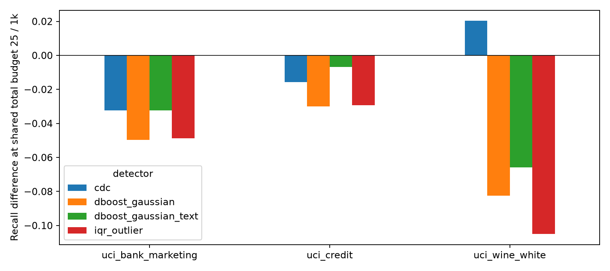
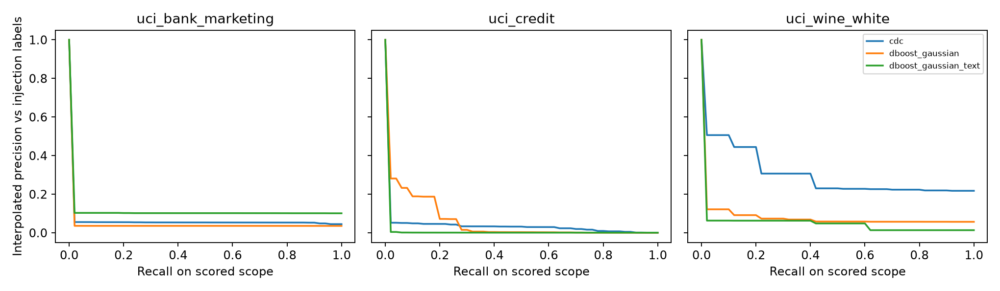
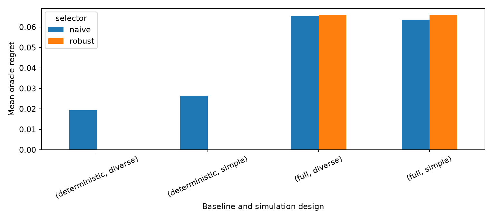

# Integrated exploratory MSc study: measured evidence and decision limits

Date: 2026-10-21. New branch `codex/thesis-integrated-research-pilot`, based on
`codex/dataset-extension-rayyan-restaurant-cars`. No merge or confirmatory claim. The question remains:
**How reliably can controlled error injection guide the selection of cell-level error detectors that
add detection value beyond conventional data-quality checks?**

## Scope and execution

This study reuses the existing contracts, generated dbt/SQL controls, historical statistics, injection
operators, partitions and detector adapters. New research code adds a shared total review budget,
case-based selection analysis and reproducible orchestration. Existing financial and published-pair
experiments are retained in their original folders. The new source is UCI white Wine Quality, 4,898
rows, 11 physicochemical features; sensory `quality` is excluded from features and error labels.

Three primary configurations are CDC-HGB, typed Gaussian dBoost and text Gaussian dBoost. These are
**two method families**, with one expressive predictive learner; IQR-reference is a binary secondary
control. Neither full LUCARIO nor a faithful Picket cell-budget adapter was qualified. Raha/HoloDetect
require labels, ZeroED external LLM knowledge, and Isolation Forest produces row scores. Their unequal
information conditions are not hidden in a common leaderboard. References, licences, implementation
changes and qualification evidence are in `thesis_literature_review.md`.

All six sources used here pass pinned SHA-256 and shape verification
(`results/thesis_integrated/dataset_verification.json`). Wine's archive/member hashes and primary
citation are in `config/datasets.yaml`; raw files remain immutable and ignored. Flights, Beers and Tax
were inspected through their existing qualification evidence before adding Wine: Flights has partial
and imputed cross-source truth, Beers mostly representation changes, and 97.6% of Tax source differences
are formatting artefacts from a BART-generated reference. Their earlier results remain historical,
unequal-information evidence, not new comparable observations.

The exact scientific protocol is `thesis_research_design.md` and `config/thesis/study.yaml`. Rates are
1%/2%; applicable families use ECAR, contextual EAR and value-dependent ENAR placement. Simple and
mixed-mechanism selection receive equal scenario counts. Primary substantive and sanity cases remain
separate. Actual changed cells, original values and realized counts are logged; zero-change cases are
failures rather than zero detector performance. Wine has no non-target categorical field or recorded
delivery chronology; these factors are unsupported, not fabricated.
The 1%/2% rates refer to rows/target-column cells in single-column scenarios, not all cells of the wide
table. Exact intended/realized counts are retained; overall cell prevalence also depends on feature width.

The seed-1 confirmatory test partition is excluded before exploratory splitting. New target partitions
are inside the design pool. The two Bank delivery sets use actual earlier/later periods; their selector
training uses only their earlier selection periods. No target injection labels or clean published-test
values configure a detector, rule or selector. Existing functional tests are verification of software,
not additional research observations or tuning evidence.

Native libraries initially ignored environment limits set after import. Two incomplete Bank runs were
stopped and an initial Wine timing/realization probe was excluded. The corrected driver enforces two
threads through native runtime APIs, preserves the aborted attempt locally and records a new freeze.
No detector, source rule, injection or selector parameter changed in response to outcomes. See
`execution_notes.json` and the final `frozen_inputs.json`. This is a computational freeze, not formal
preregistration; earlier pilot outcomes were already known.

## Interpretation of metrics and uncertainty

The primary quantity is a **signed recall difference at the same total review cap**, not all baseline
hits plus an extra free ML queue. At 10/25/50 unique cells per 1,000 rows, augmentation reserves half
(rounding up) for baseline flags, then novel detector cells; unused novel capacity returns to baseline.
Flag ordering and score ties use uniform seed-0 priorities without labels. Genuine finite scores can
rank all scored cells; binary methods provide flags only. A useful baseline cell can be displaced,
so negative gain is meaningful. The 50/50 policy is provisional; it does not test optimal fusion or
severity-aware rule prioritization.
Baseline B has a superset of native control flags, but that does not guarantee greater recall in a
capped randomly ordered queue: additional statistical alerts can also dilute review priority. Thus
the A/B contrast measures both coverage and workload under this policy, not an abstract monotone
notion of baseline strength.
Queues need not spend every available slot: a baseline with few flags can underfill, while a scored
detector can use spare capacity. Actual baseline and augmented review counts are retained in the case
and family summaries. Positive utility under baseline A can therefore include using previously unused
review capacity; this is a budget-constrained addition, not a claim of identical realized review cost.

Recall, precision lower bounds and AP refer to **injected positives**, not adjudicated absence of errors
in untouched cells. AP uses all finite scored cells and must be read with scored-positive coverage;
untouched alerts remain burden, never verified false positives. PR figures show a fixed
first-test-case-per-family precision-envelope sample and are illustrative, not pooled gold-label curves.
Native workload is separate from budget-capped reviews. IQR has no invented continuous score.

Repeated splits and injection seeds share records. Case-level summaries average those dependencies
before bootstrapping cases; intervals describe conditional sensitivity to the sampled error cases,
not population uncertainty across independent datasets. Selector and simulation-design contrasts are
paired on identical targets and reported descriptively. Three domains cannot support a universal
transfer or significance claim. Aggregate scenario totals are workload, not independent sample size.

Budgets are normalized by rows, not feature count: Credit has more distractor cells than Wine, so
cross-source recall differences are not a controlled estimate of domain effects. Source histories are
presumed usable, not independently error-free. Conformal confidence 0.999 with 512 calibration rows
and rare categories is not a verified 99.9% coverage guarantee. Typed/text dBoost changes representation
and scored coverage; a mode difference is not an independent algorithm replication. The overlap tables
compare successful **augmented queues**, including baseline hits shared by them, rather than isolated
native detector overlap. Worker memory values are upper bounds over a reused worker's lifetime.
The rate/strength stress test jointly changes the case, conditioning/direction and strength as well
as rate; it is not an isolated causal strength effect. Simple/diverse selection uses the same families
and equal scenario counts. Family exclusion is a stress test, not an equally powered factorial
intervention on family diversity, so comparisons of those factors remain descriptive.

The new analyses do not automatically replace the live service's earlier evidence/recommendation
policy. Operational adoption under this new allocation rule still needs explicit policy qualification
and adjudicated feedback. Statistical explanations support review; they do not establish correctness.

## Measured results

### What actually ran

Eleven complete replications evaluated **3,318 successful scenarios**, with all four configured detectors
successful in every replication: 44 configuration fits and 13,272 corrupted-scenario detector evaluations.
There were **110 failed injections out of 3,428 planned**, not detector failures: 104 in the two Bank
period sequences and six chloride-substitution cases in Wine split 11. Wine splits 12/13 could realize
that case; its feasibility depends on the available historical values and the inherited materiality floor.
Nothing was changed to rescue it. Counts include selection and sanity work, not independent test cases.

| Source | Random runs | Actual delivery runs | Successful scenarios | Failed injections | Reserved rows |
|---|---:|---:|---:|---:|---:|
| Credit | 3 | 0 | 1,206 | 0 | 6,003 |
| Bank | 3 | 2 | 1,536 | 104 | 8,236 |
| White Wine | 3 | 0 | 576 | 6 | 959 |

The actual changed-cell logs match scenario counts and unique cell identities in all eleven runs.
The SQL input stacks contain **zero reserved or non-design rows**; no injection enters the reference
or reserved partition (`holdout_audit.csv`). The same hashed partitioning code creates the model inputs.
The primary case-balanced summaries have 24 Credit, 21 Bank and 11 Wine cases, after averaging dependent
scenario repetitions. Different available cases/periods prevent a balanced full factorial.

Final runs took 2,886.8 summed job seconds (48.1 minutes), with two workers; summed job time is not wall
time. Individual replications took 63.9–433.4 seconds. The largest recorded worker lifetime peak was
8,470 MiB; this is an upper bound for later jobs in that reused worker, not each dataset's own peak.
The aborted import-order attempt is outside these totals. All recorded native pools in final workers
report two threads.

### 1. Additional value depends on the baseline and error population

At the primary **25 total reviews per 1,000 rows**, the table shows case-balanced recall percentages
and **percentage-point gains** over the corresponding capped baseline. Brackets are conditional
case-bootstrap 95% sensitivity intervals for CDC, not population confidence across datasets.
IQR is secondary; dBoost modes are one method family.

| Source | Baseline | Baseline recall | CDC gain [case interval] | dBoost typed gain | dBoost text gain | IQR gain |
|---|---|---:|---:|---:|---:|---:|
| Credit | A: deterministic | 2.78% | **+8.50 [3.97, 13.82]** | +4.08 | +4.09 | +0.43 |
| Credit | B: + statistics | 6.04% | −1.56 [−3.68, 0.62] | −3.00 | −0.67 | −2.93 |
| Bank | A | 8.81% | **+8.06 [0.02, 17.78]** | −0.43 | +4.49 | −1.69 |
| Bank | B | 9.69% | −3.23 [−7.12, 0.42] | −4.96 | −3.22 | −4.86 |
| Wine | A | 7.03% | **+35.15 [12.65, 54.84]** | +13.27 | +9.82 | +1.25 |
| Wine | B | 23.99% | +2.03 [−12.99, 17.12] | −8.25 | −6.58 | −10.49 |

**Measured conclusion:** these learned implementations can add useful injected-error coverage over
baseline A. They do not show a stable, universal positive gain over B. Wine's B point estimate is
positive but highly case-sensitive; intervals spanning zero do not establish a reliable gain. This
is not evidence that every learned method or every alternative review policy is ineffective.



Budget sensitivity also matters. CDC's A gains at 10 / 25 / 50 reviews are Credit **0.88 / 8.50 / 14.88**,
Bank **2.15 / 8.06 / 14.17**, Wine **21.79 / 35.15 / 48.41** pp. Against B, its 50-review gains are
−0.77 / −5.79 / +10.39 pp respectively. A decision at one budget cannot be silently generalized to another.
All baselines, standalone policies, actual review counts, precision lower bounds, AP and scored coverage
are in [`tables.md`](../results/thesis_integrated/tables.md) and the case/family CSVs.

### 2. Error family, mechanism and representation

With B, CDC's family means range from −8.22 pp (keying) to +4.82 pp (valid categories) on Credit;
−12.09 (scale) to +2.01 (valid categories) on Bank; and −30.00 (scale) to +19.33 (substitution) on Wine.
Wine precision/rounding errors give +11.04 pp, while dBoost text gives +15.42 pp on that family.
Conventional envelopes already cover many gross unit changes; reviewing novel detector candidates can
displace useful scale-error alerts. Predictable cross-attribute substitutions can offer a different gap.
These are case-set observations, not a guarantee that all categorical/substitution errors are detectable.

Matched test-diverse placement contrasts at B/25 are smaller on average but nonzero: EAR / ENAR minus
ECAR changes CDC's gain by **+0.45 / −0.61 pp** on Credit, **+0.70 / +1.28 pp** on Bank, and
**−1.81 / −1.85 pp** on Wine. Bank text-dBoost's ENAR contrast is +4.02 pp. Some case/mechanism
combinations are absent; EAR is excluded when its conditioning field is the corrupted target itself.
Family ranges and the A/B changes are larger than these average contrasts here. This is descriptive,
not a variance decomposition proving that one factor causally explains more in general.

Scored-positive coverage is 100% for CDC/text dBoost but only **91.71% on Credit and 95.24% on Bank**
for typed dBoost, which can lose changed rows to parse/type requirements. Its finite-scope AP cannot
be interpreted without that coverage. For example, with B on Bank, text dBoost's AP is 9.42% versus
CDC's 8.05%, yet both have about −3.2 pp mean incremental utility. A standalone ranking and an addition
to a rule queue are different decisions.



Native workload raises a separate operational concern: on untouched Bank target partitions, full controls
flag 2,552.7 cells/1,000 rows and CDC flags 3,240.9; respective Credit counts are 60.6/59.6 and Wine
23.4/25.7. These are alert burdens under source/period changes, not measured false-positive rates.
Rules and statistical explanations execute, but this is not evidence of production-ready alert precision.
Average CDC fit/score seconds are Credit 58.2/250.7, Bank 44.8/141.4, Wine 14.1/25.4. dBoost is much
cheaper: typed fit/score approximately 0.03/6.09, 0.15/4.36 and 0.01/1.26 seconds respectively.
These scoring times cover all scenarios with the existing changed-row optimization, not one live batch.

### 3. Selection succeeds in some conditions and fails under shift

The 2,424 selector decisions cover all three budgets, both baselines, simple/diverse selection,
matched/held-out cases, rate/strength shifts, leave-family-out and leave-source-out conditions. They are
dependent decisions, not 2,424 independent studies. The following primary-budget regrets are percentage
points against the target's best compatible configuration **including NO_ADDITION**. Each source is
shown separately; Bank includes its three random and two temporal replications.

| Source / baseline | Naive: simple simulations | Naive: diverse simulations | Robust: simple | Robust: diverse |
|---|---:|---:|---:|---:|
| Credit A | 5.69 | 3.52 | 0.00 | 0.00 |
| Bank A | 2.27 | 2.27 | 0.00 | 0.00 |
| Wine A | 0.00 | 0.00 | 0.00 | 0.00 |
| Credit B | 0.35 | 0.83 | 0.83 | 0.83 |
| Bank B | 0.26 | 0.26 | 0.45 | 0.45 |
| Wine B | **18.50** | **18.50** | **18.50** | **18.50** |

These are held-out column×operation cases; explicit whole-family exclusions are also reported in
`selection.csv`. On those family exclusions with B, robust/naive mean regrets are Credit 1.59/3.02 pp,
Bank 1.20/1.56 pp, Wine 9.40/10.63 pp (descriptive rounded summaries). No independent-resplit significance
claim follows from those differences.

Mechanism diversity improves naive Credit-A held-out regret by 2.16 pp, worsens Credit-B regret by
0.48 pp, and changes neither Bank nor Wine held-out regret. The robust selector is unchanged by this
design contrast. There is no consistent measured superiority of mixed placement alone.

The strongest failure is Wine B: both selectors correctly choose NO_ADDITION on matched simulations
(regret zero), then keep that action on new cases where CDC is useful. Held-out regret rises to
**18.50 pp**, rate/strength-shift regret to **21.67 pp**, and leave-entire-source-out regret to **21.24 pp**.
Target labels compute those oracle comparisons only; they never reconfigure the selector. Caution about
observed families does not protect against unrepresented useful error populations.

Robust selection helps with A: under diverse selection its mean signed additional injected hits per
scenario are Credit **+3.78** versus naive +2.63, Bank **+0.42** versus −0.60, and Wine **+2.60** for both.
These counts average dependent copied scenarios with different row counts/rates; they are not unique
real-world defects. With B at budget 25, robust selects no addition in every held-out decision. This prevents
some losses but also misses gains, so the guard is **not universally superior** to mean selection.

The temporal evidence is mixed rather than hidden in a random-split average. In Bank delivery set 1,
A-naive selects typed dBoost and loses 2.38 pp; robust abstains and incurs zero regret. With B on that
same delivery, naive text-dBoost gains 1.03 pp but misses the 2.25 pp CDC oracle; robust abstains and
misses all 2.25 pp. In delivery set 2, NO_ADDITION is optimal for both baselines; B-naive loses 0.08 pp,
while robust takes no addition. Many month-swap scenarios were infeasible in these narrow periods.



### 4. Published transfer is a bounded negative check

At 25 reviews, simulation selection restricted to compatible matching dBoost configurations picks text
dBoost with A on Restaurant/Cars. Both selectors then **lose 7.81 pp and 4.01 pp**, respectively,
relative to the capped completeness baseline. With B both choose NO_ADDITION and have zero regret.
The target oracle is no addition: every labelled missing positive is already in the native completeness
flags, so a novel-detector queue cannot contribute a new positive of that kind. Rayyan's gain/regret
remain undefined, not zero. Detailed label and compatibility qualifications follow below.

This is evidence of a selector/policy mismatch on a missingness-only synthetic target, not confirmation
or refutation of performance on independently verified natural substantive errors. It exposes the
need to qualify the target error population and baseline ceiling before transferring a recommendation.

### Answers to the nine research questions

| Question | Evidence-based answer |
|---|---|
| 1. Do learned detectors add beyond controls? | Yes over A in these injected populations; positive mean gain over B is not stable across sources/cases. |
| 2. Under which characteristics/families? | Predictable cross-attribute Wine substitutions and some valid-code cases offer gaps; many gross scale errors are already covered. Width, typing, predictability and rule coverage differ jointly. |
| 3. Does placement matter? | It changes measured utility, including +4.02 pp for Bank text-dBoost ENAR versus ECAR; mixed placement does not consistently improve selection. |
| 4. Can simulations select a detector? | Sometimes: robust finds the held-out A oracle in these splits, but naive has nonzero regret and recommendations are baseline-dependent. |
| 5. What happens when errors differ? | Wine B moves from matched regret 0 to 18.50 pp on held-out cases; whole-source and rate/strength stresses also fail. |
| 6. Is robust better? | It improves A held-out choices and reduces some family-shift losses, but can abstain away useful B gains. No universal win. |
| 7. Does the conclusion hold on published pairs? | Only a missingness-ceiling/negative-transfer check is identifiable. Natural substantive-error transfer remains unestablished; Rayyan is unscorable. |
| 8. What is new? | A candidate empirical contribution about selection conditional on an existing rule suite and shared total review cap, including abstention and qualified labels. Algorithms, simulation selection, robust optimization and error mechanisms are not inventions here. Literature priority remains provisional. |
| 9. What remains? | Supervisor agreement, a sharper novelty check, method-fidelity qualification or an explicit two-family scope, independently adjudicated substantive labels, allocation/selector sensitivity and an independently frozen confirmatory protocol before unlocking the reserved evaluation. |

### Recommended MSc scope: proceed, but narrow the claims

Keep the research question. Proceed with **conditional decision reliability**, including failures,
review cost and no-addition; do not promise generic natural-error superiority. The current package
supports an empirical MSc direction, not a completed thesis or a newly validated robust-selection method.

| Dataset / method | Recommended role |
|---|---|
| Credit, Bank | Primary controlled sources; Bank temporal results separate, with infeasible cases disclosed. |
| White Wine | Useful independent chemistry-domain controlled source; no native DQ truth, categorical or temporal counterpart. Retain failed realizations. |
| Restaurant, Cars | Reproducible missingness/formatting sanity and baseline-ceiling checks; insufficient primary evidence for subtle natural errors. |
| Rayyan | Workload/explanation/adjudication study; no automatic error-accuracy or selector-regret claim. |
| Flights / Tax / Beers | Historical supplementary evidence with partial/imputed truth, BART/formatting or representation limitations; not interchangeable primary gold labels. |
| CDC-HGB + dBoost typed/text | Defensible narrow common historical-information track, with adaptation and coverage limits explicit. Do not count the two dBoost modes as independent methods. |
| IQR-reference | Cheap binary secondary comparator, with budget underfill and no fabricated score. |
| Full LUCARIO / Picket | Qualify fidelity, operational cell interface, dependencies and licence evidence before inclusion. |
| Raha / HoloDetect / ZeroED / row detectors | Separate labelled, LLM/external-knowledge or row tracks; not equal-information primary competitors. |

Before confirmation, assess reasonable allocation/selector sensitivity on development data without
choosing a favourable result, obtain independent substantive error adjudications and decide whether a
second expressive learner is required. If those labels cannot be obtained, narrow the external-validity
claim to controlled robustness and abstention. The reserved confirmatory evaluation remains unopened
for research, and supervisor approval is separate.


## Published-reference validation and service explanations

The nine earlier dirty-only scans are reused with verified prediction-artifact hashes, without refitting
or injecting new errors. This evaluates a new queue policy on existing predictions, not nine new
independent replications. Earlier audits had exposed reference differences, so this is not pristine
external confirmation. Restaurant/Cars are published **synthetic missingness** variants, not independently
verified natural substantive errors. Rayyan has uncertain repairs, encoding/date/sentinel differences
and missing reference values; its accuracy and selector regret remain undefined.

Full-source qualification finds 125 eligible Restaurant missing differences after excluding 30 `class`
annotations, and Cars has 110 missing plus 710 numerically equivalent formatting differences. The
numerical-format changes are not counted as errors. The three overlapping batch resamples retain their
own label counts and uncertainty costs; they are not independent sources.

CDC's earlier Cars predictions used 32 calibration rows. This study fixes 512; Cars histories cannot
support the same configuration. High-cardinality names/titles also make CDC unsuitable for Restaurant
and Rayyan. Consequently **configuration-matched selector transfer includes dBoost variants only**;
incompatible CDC is absent, never zero-filled. Binary LUCARIO-core is partial historical evidence,
not a newly reproduced full method.

Existing `dqf scan` outputs include rule evidence/status, detector source, cell identity, score and
explanation, and feedback supports confirmed/uncertain judgements. Earlier scans and the current
integration tests establish executable findings production. Model residual/deviation explanations are
statistical reasons to review a cell, not a validated diagnosis or evidence that a repair is correct.
None of the published pairs supplies newly adjudicated substantive errors in this common track.

## Comparison with the earlier financial pilot

The earlier 14-replication pilot remains in `results/pilot/` and `comprehensive_pilot_report.md`. It used
additional ML capacity beyond all baseline alerts, different detector configurations/calibration,
more resplits and partial/transductive secondary methods. The current study instead charges every
baseline review to the total queue and can displace useful alerts. Its three primary configurations,
new chemistry source and eligible source-transfer sets differ. Therefore numerical gains must not be
pooled or interpreted as a replication of the old primary effect size. The shared question concerns
conditional selection reliability; observed old rankings are context, not independent confirmation.

## Reproduction and verification

```bash
uv sync --frozen --extra dev --extra figures
source .venv/bin/activate
export OMP_NUM_THREADS=2 OPENBLAS_NUM_THREADS=2 OMP_WAIT_POLICY=PASSIVE
export DBT_SEND_ANONYMOUS_USAGE_STATS=false
export MPLCONFIGDIR=/tmp/dqf-matplotlib XDG_CACHE_HOME=/tmp/dqf-cache
python scripts/download_datasets.py uci_credit uci_bank_marketing uci_wine_white
python scripts/download_datasets.py raha_rayyan jung_restaurant jung_cars
python scripts/verify_datasets.py uci_credit uci_bank_marketing uci_wine_white raha_rayyan jung_restaurant jung_cars
python scripts/run_thesis_study.py --workers 2
python scripts/analyse_thesis_study.py
python scripts/validate_thesis_transfer.py
python scripts/render_thesis_tables.py > results/thesis_integrated/tables.md
ruff check src scripts tests
python -m pytest -q -ra
```

`run_thesis_study.py` resumes only intact completed outputs matching frozen inputs. Use `--dataset`,
`--scheme`, `--seed`, `--workers 1` for bounded subsets and a separate `--out` for changed inputs.
Do not overwrite earlier runs. Committed summaries and manifests are in `results/thesis_integrated/`;
exact cell/value injection logs and full dbt evidence remain under ignored `results/runs/`.

Published transfer requires the prior nine frozen scans. In a fresh checkout, reproduce that phase at
commit `d0b7591bdbf27dc0a3d1b167a3a44fa31d8f0ff2` using
`python scripts/evaluate_real_error_benchmarks.py`, preserving its ignored run directory before returning
to this branch. Its original evaluator deliberately rejects later code/config changes. The new transfer
script verifies the saved prediction hashes and reads labels only for eligible batch rows. It will fail
clearly if those artifacts are absent or altered. Runtime/timestamps and acquisition paths can vary;
scientific tables, partition seeds and queue choices should reproduce in the locked environment.

Verification completed: one fresh Wine seed-11 run reproduces all nine checked scientific output files
byte for byte; repeating the analysis reproduces all 20 generated summary/provenance files exactly.
Resuming the main study validates output hashes, reuses all eleven runs and schedules zero jobs. These
are reproducibility checks, not extra independent observations. Test/validation details are recorded
in `results/thesis_integrated/validation.json`.
The final local suite passed **199 tests**, with five explicit skips (two absent optional Kaggle sources
and three original-dBoost-environment tests); dbt integration and repository hygiene executed. Ruff and
the staged whitespace check pass. The original-method fidelity claims remain historical qualification,
not newly executed original dBoost/AutoGluon replications.
